<p align="center"></p>

Grab the kit. Build something worth running on a 360. You get a small SDL3 + Vulkan app, pinned build scripts, an XBDM client and the lessons Tube360 made us learn. Read the code, make it yours and bring the console record when you submit app changes. MIT for our code; upstream libraries retain their own licenses.

Credit to [xsdk](https://github.com/xenosworks/xsdk), [vulkan4xenon](https://github.com/xenosworks/vulkan4xenon), [SDL-xenon](https://github.com/xenosworks/SDL-xenon) and the work of [Free60/libxenon](https://github.com/Free60Project/libxenon). Their work gets this kit on the screen. Keep the credit and read the [provenance audit](docs/provenance.md) before changing dependencies.

**Development state:** PC and Xbox builds have been produced. The exact R1 XEX was accepted on **2026-11-25** by the coordinator and owner on **one Xbox 360 E (Corona), BadUpdate + Aurora**. See the [acceptance record and limits](docs/console-test.md). Future binaries need their own acceptance. No binary release is claimed. The example title ID is `0x52563330`; choose another for your app.

Owner and initial maintainer: [Pedro](https://github.com/PedroHenrique0713).

**Risk notice:** Homebrew can lead to Xbox Live account/console bans, data loss or console damage. Use at your own risk. Software is **as is** under its license; neither review nor a badge guarantees safety or compatibility.

**Privacy:** No telemetry or hidden collection. Login credentials/tokens must stay on the console and out of issues/logs; any future collection requires explicit opt-in. `net_log.txt` enables developer-selected UDP diagnostics; keep it private, use trusted networks and never log credentials.

Organization: [`revive360`](https://github.com/revive360). Follow its [review levels/checklist](https://github.com/revive360/.github/blob/main/REVIEW.md), [required README notices](https://github.com/revive360/.github/blob/main/APP_README_TEMPLATE.md) and [CI capacity plan](docs/ci.md). Contribution commits require DCO (`git commit -s`). No self-review except founder Pedro, with the exception recorded. Security: private vulnerability reporting (48-hour initial response); public support: [official Discussions](https://github.com/orgs/revive360/discussions). No donations are received/split by the org.

The shared CI image is `ghcr.io/revive360/devkit:recipe-<recipe-sha256>`. Apps pin its approved OCI digest. See [image stages, source materials and verification](docs/ci.md#building-and-consuming-the-public-image). Initial publication/public visibility must be verified before consuming it.

## Get the first app on screen

Give the toolchain its time. The quick loop starts after the PC and console are ready. Start with [homebrew in 2026](docs/homebrew-2026.md). On Linux, install CMake 3.25+, Make, Python 3.12+, a C/C++ compiler, SDL3 3.2+ development files, Vulkan headers/loader/driver and `glslangValidator`. The cross compiler also needs the build dependencies listed by xsdk. Windows users can use Linux in WSL for building; this workflow has not been verified on macOS.

With the xsdk PowerPC toolchain and your prepared console ready, run this from the repo root:

```sh
# Run from this repository's root. No machine-specific config is loaded.
export XSDK_TOOLCHAIN=/absolute/path/to/xsdk-gcc
scripts/bootstrap.sh       # fetch pinned sources and build libraries, all at -j2
scripts/build.sh pc        # build/pc/hello
./build/pc/hello           # window + controller, Escape also exits
scripts/build.sh xbox      # build/xbox/hello.xex
python3 scripts/package.py # dist/hello/default.xex + development ZIP and source
```

If you have no toolchain yet, use `scripts/bootstrap.sh --toolchain`; by default it installs privately into `.deps/toolchain`. It takes substantially longer and uses several GB. `XSDK_TOOLCHAIN` selects an alternative install prefix; do not select an existing prefix when rebuilding a toolchain. Sources/downloads/builds stay outside Git.

Get the CLI ready:

```sh
python3 -m venv .venv
.venv/bin/pip install -e '.[screenshot]'
.venv/bin/xbdm --help
# No install alternative:
PYTHONPATH=src python3 -m revive360.xbdm --help
```

Close the loop with the [console test procedure](docs/console-test.md): discover your console, create a dedicated app directory, copy `default.xex`, optionally add a private `net_log.txt`, listen on UDP and launch with the correct working directory. The template draws text, logs startup and a five-second heartbeat, responds to A, and exits normally on B. Never reboot to stop it.

[Português: do zero ao primeiro app](template/README.md) · [XBDM and captures](docs/xbdm.md) · [GCC int64 bug](docs/compiler.md) · [Xenos performance](docs/performance.md) · [validation](docs/validation.md)

On the shared Tube360 development machine, keep **bootstrap and Xbox builds** in the same queue:

```sh
flock ${XDG_RUNTIME_DIR:-/tmp}/revive360-xbox.lock \
  systemd-run --user --scope -q -p MemoryMax=6G -p MemorySwapMax=1G \
  scripts/build.sh xbox
```

Use the same wrapper for `scripts/bootstrap.sh`; `XSDK_TOOLCHAIN` must be exported. The lock path above belongs to Pedro's shared host, not a required username on another developer's PC.

Send a focused fix, explain the code and follow the eleven [house rules](https://github.com/revive360/.github/blob/main/profile/README.md#rules). Bring a useful difference when you turn the template into an app.

Xbox and Xbox 360 are trademarks of Microsoft. Revive360 is independent and is not affiliated with or endorsed by Microsoft. No Microsoft SDK, keys, games, console unlocker or XBDM monitor is included. Community rules live in the organization's `.github` repository; every release needs a real-console test.
